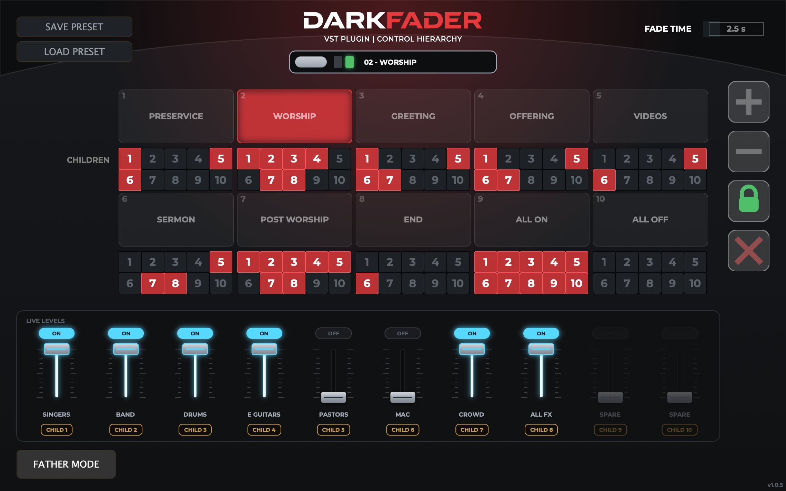
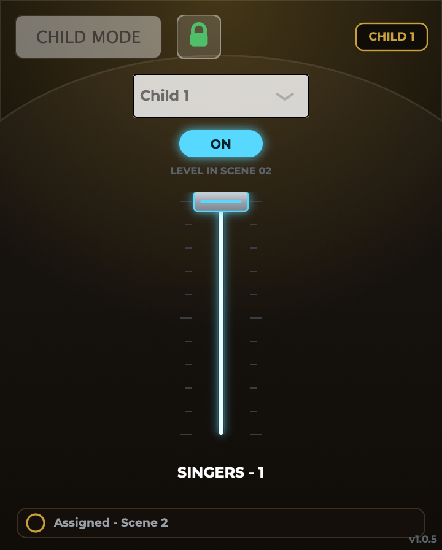

# DarkFader

**Scene-based bus switching and fading for live mixing, as a VST3 / AU plugin.**

DarkFader lets one plugin instance (the **Father**) drive the levels of up to ten others (the **Children**) across up to 32 named scenes. Put a Child on each bus you want to control, and the Father on any track. Click a scene and every Child fades to its level for that scene over a set fade time, with no jumps even if you change scenes mid-fade.

It was built for a church livestream mix (pre-service, worship, sermon and so on), but it works anywhere you need repeatable, smooth bus changes from one place.



## Features

- **Father / Child hierarchy.** One Father controls up to 10 Children in the same session, with no MIDI routing or automation lanes needed.
- **Up to 32 named scenes** in a grid. Each scene stores a level for every Child (on, off or anywhere between). Add or remove scenes with **+** / **−**.
- **Jump-free fades.** Every Child ramps from wherever it is right now, so changing scenes mid-fade never snaps. A regression test (`Tools/RampTest`) covers this.
- **Global fade time** set from the Father.
- **Live levels** strip on the Father: one fader per Child, labelled with that Child's track name.
- **Lock** protects the scene setup from accidental edits during a service. **Kill (✕)** is a global bypass: every Child snaps to unity gain, so all busses pass audio untouched until you turn it off.
- **Presets.** Save and load the whole rig as a `.puppet` file. An example from a real Sunday service is in [`Tools/sunday.puppet`](Tools/sunday.puppet).
- **Child view.** Each Child shows its assigned slot, its state in the current scene, and its level. Unassigned Children pass audio through untouched.

<p align="center"></p>

## Building

Requirements: CMake 3.20+, a C++17 compiler (Xcode / Command Line Tools on macOS, Visual Studio 2022 on Windows) and Git. JUCE 7.0.9 is downloaded automatically by CMake.

```bash
cmake -S . -B build -DCMAKE_BUILD_TYPE=Release
cmake --build build --config Release
```

Outputs land in `build/DarkFader_artefacts/Release/` (`VST3/`, `AU/` on macOS, and `Standalone/`).

### macOS installer

`./build-installer.sh` builds the AU and VST3 and packages them into `build/DarkFader.pkg` with [Packages](http://s.sudre.free.fr/Software/Packages/about.html). The package installs into `/Library/Audio/Plug-Ins/`.

### Developer tools (optional)

Configure with `-DDARKFADER_DEMO_RIG=ON` to also build:

| Target | What it does |
|---|---|
| `DarkFaderDemoRig` | One Father and eight Children in a single app, for testing the UI without a DAW |
| `DarkFaderRampTest` | Console regression test for jump-free fades (prints `PASS`) |
| `DarkFaderSnapshots` | Renders the plugin windows to PNG: `DarkFaderSnapshots <outDir> [preset.puppet]` |

## Notes

- Father and Children find each other through a shared in-process hub. They must run in the same plugin host process, which is the default in Logic Pro and most DAWs.
- Built with [JUCE](https://juce.com) under its own license terms. The UI font is [Montserrat](https://fonts.google.com/specimen/Montserrat) (SIL Open Font License 1.1).

## License

Copyright © 2026 benjaminwellssss. All rights reserved. The source is published for viewing only; see [LICENSE](LICENSE).
